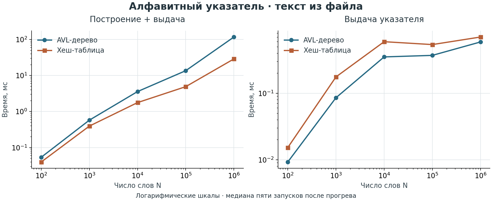
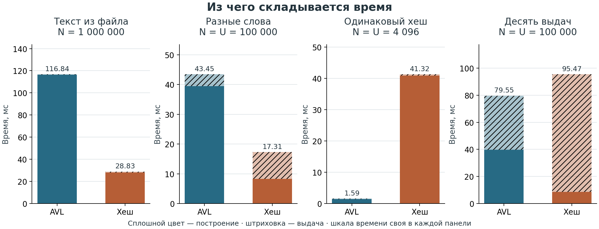
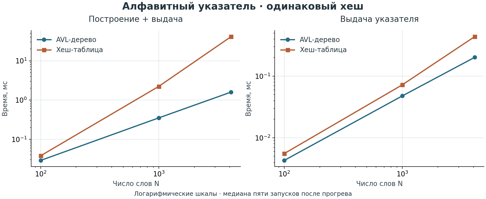

# Алфавитный указатель

В этой лабораторной я строю алфавитный указатель текста и сравниваю два способа
хранения слов: AVL-дерево и хеш-таблицу. Для каждого слова сохраняю страницы,
на которых оно встретилось, а затем выдаю весь указатель по алфавиту.

**C++17** · **Python 3.10+** · **Tkinter** · **Свои структуры данных**

[Запуск](#запуск) · [Результаты и графики](#результаты-и-графики) ·
[Проверки](#проверки) · [Устройство проекта](#устройство-проекта)

## Запуск

Использую компилятор с поддержкой C++17, `make` и Python с Tkinter.
Для самого приложения дополнительные библиотеки Python не нужны.

```sh
python3 -c "import tkinter"
make
```

Запускаю команды из корня проекта. `make`, `make run` и `python3 gui.py`
открывают одно и то же окно. При первом сравнении программа собирает адаптер C++
с `-O2` во временной папке; при следующих построениях использую готовый файл.

В `index_text.txt` уже лежит **1 000 000 слов**, из них **8 208 разных**.
Текст синтетический: 8 192 латинских слова и 16 русских, с большим числом повторов.
Для воспроизведения файла использую `make generate-text`: начальное значение
генератора фиксирую числом `1323`.

### Работа с окном

1. Задаю число слов **N**, размер страницы и единицу размера: слова или байты UTF-8.
2. Нажимаю **«Сравнить»**. Для обоих словарей получаю время построения, выдачи
   указателя и их сумму. Программа читает ровно первые N слов файла.
3. Просматриваю текст по страницам и указатель. Поиск переводит к первой странице
   слова и подсвечивает вхождения; страницы листаю блоками по десять.
4. Кнопкой **«Экспорт CSV»** сохраняю все успешные замеры текущего запуска окна.

Сравнение выполняю в фоне. Если данных меньше N, слово не помещается на страницу
или параметры неверны, показываю ошибку и сохраняю предыдущий результат.
Для своего текста заменяю `index_text.txt` файлом в UTF-8.

## Результаты и графики

Замеры ниже получил **8 ноября 2026 года**, macOS arm64, Apple clang 21.0.0,
C++17, `-O2 -DNDEBUG`. Полные результаты сохраняю в
[index_performance.csv](index_performance.csv), исходную гипотезу — в
[Tests/IndexHypothesis.md](Tests/IndexHypothesis.md).

### Как влияет объём текста



На префиксах файла хеш-таблица быстрее по сумме построения и выдачи во всём
проверенном диапазоне. На миллионе слов получаю **116,836 мс** у дерева и
**28,828 мс** у хеш-таблицы: разница примерно в **4,1 раза**.
Обе шкалы логарифмические, поэтому на одном графике видны и малые, и большие N.

### Построение и выдача отдельно



Сплошным цветом показываю построение, штриховкой — выдачу указателя.
Для каждой панели использую свою шкалу времени. В сценарии десяти выдач строю
словарь один раз, затем десять раз получаю независимый список записей.

| Данные | N | Разных слов | AVL, мс | Хеш-таблица, мс |
| --- | ---: | ---: | ---: | ---: |
| Первые слова файла | 100 | 86 | 0,054 | 0,040 |
| Первые слова файла | 1 000 | 739 | 0,577 | 0,394 |
| Первые слова файла | 10 000 | 4 890 | 3,582 | 1,771 |
| Первые слова файла | 100 000 | 8 207 | 13,591 | 4,897 |
| Первые слова файла | 1 000 000 | 8 208 | 116,836 | 28,828 |
| Разные слова, перемешаны | 100 000 | 100 000 | 43,454 | 17,309 |
| Одинаковый хеш | 4 096 | 4 096 | 1,592 | 41,321 |
| Разные слова, десять выдач | 100 000 | 100 000 | 79,548 | 95,469 |

В таблице привожу **построение + выдачу**, в миллисекундах. Чтение файла и работа
интерфейса сюда не входят.

### Что происходит при коллизиях



Для этого случая составляю разные слова из блоков `Aa` и `BB`: их полиномиальные
хеши совпадают. Хеш-функцию оставляю прежней. При 4 096 разных ключах дерево
быстрее примерно в **26 раз**: у таблицы все записи попадают в одну цепочку.

### Мой вывод

Для обычного текста и однократной выдачи выбираю **хеш-таблицу**. Даже при
100 000 разных слов сортировка результата не перекрывает выигрыш построения.
При большом числе повторов с 16 или 128 разными словами она также быстрее.

**AVL-дерево** выбираю при большом числе коллизий и частой выдаче всего указателя.
На 100 000 разных слов десять выдач после одного построения быстрее у дерева.
Если сохранить уже выданный список и пользоваться им повторно, повторных
сортировок не будет — этот сценарий нужно рассматривать отдельно.

Универсальную границу по N не задаю. На результат влияют число разных слов U,
длина ключей, распределение хеша, списки страниц и число выдач.
Время зависит от компьютера и фоновой нагрузки; разницу меньше 5% считаю близким
результатом. Скорость конкретной реализации не является условием успешного теста.

### Как обновляю графики

Для построения изображений отдельно устанавливаю Matplotlib:

```sh
python3 -m pip install -r requirements-plots.txt
make index-performance
make plots
```

`make index-performance` обновляет CSV, `make plots` строит три PNG в `Results/`.
Графики получаю из измерений программы, значения вручную в скрипт не переношу.
Числа в таблице выше относятся к сохранённому замеру; после нового эксперимента
обновляю их отдельно.

Экспорт окна тоже поддерживаю:

```sh
python3 plot_results.py index_measurements.csv --output Results/my_measurements
```

Для каждого размера и режима страниц получаю отдельный график. Если один N
измерен несколько раз, использую последний замер из файла.

## Методика измерений

Сначала делаю прогрев, затем пять запусков на одних данных, меняя очередность
словарей. Для каждого словаря выбираю целиком медианный по общему времени запуск:
время построения и выдачи оставляю из него же.

В `Build` включаю разбор текста, разбиение на страницы и заполнение словаря.
В `GetEntries` — получение независимого указателя по алфавиту. Для хеш-таблицы
в этот этап входит быстрая сортировка указателей на записи.
Чтение файла, подготовку входных данных, проверку результата, освобождение
выданного списка и вывод оставляю вне измеряемых участков.

Кроме префиксов файла проверяю прямой, обратный и перемешанный порядок разных
слов, повторы, длинные ключи, коллизии, размеры страниц и повторную выдачу.
В CSV поле `outputs` задаёт число выдач, `entries_ms` — их суммарное время.
Во всех сценариях сравниваю слова и все номера страниц двух реализаций.

## Проверки

| Команда | Что проверяю |
| --- | --- |
| `make test` | Контейнеры, последовательности, AVL, словари, указатель и адаптер Python/C++ |
| `make sanitize` | C++-тесты с AddressSanitizer и UndefinedBehaviorSanitizer |
| `make performance` | Добавление, поиск, удаление в словарях и число копирований при Append |
| `make index-performance` | Построение и выдачу указателя во всех сценариях, с сохранением CSV |

В тестах адаптера проверяю миллион слов, границы N, ошибки параметров,
передачу UTF-8 и специальных символов через JSON, совпадение страниц Python и C++.
Отдельно проверяю копирование, перемещение, исключения, сохранение прежнего
результата при ошибке и пустые указатели на функции.
Ошибка проверки даёт ненулевой код завершения. Исполняемые файлы сохраняю в `build/`.

На macOS дополнительно проверяю утечки после выполнения C++-тестов:

```sh
leaks --atExit -- ./build/tests/alphabetical_index_tests --test
```

При проверке 8 ноября все 318 проверок C++, тесты адаптера и санитайзеры прошли;
`leaks` сообщил **0 утечек, 0 потерянных байтов** на выполненных сценариях.

## Правила разбиения текста

При чтении файла заменяю переносы строк, табуляцию и повторные пробелы одним
пробелом между словами. Регистр и пунктуацию сохраняю.

- Размер полной страницы задаю в словах или байтах UTF-8, не меньше двух.
- Первая страница вмещает половину размера, каждая десятая — три четверти
  с округлением вниз.
- В байтовом режиме учитываю байты `std::string` и один пробел между словами.
  Русская буква в UTF-8 занимает несколько байтов.
- Слова не разрываю: слишком длинное слово вызывает ошибку.
- Для каждого слова сохраняю номер страницы один раз.
- Записи упорядочиваю лексикографически, как строки `std::string`.

В C++-класс `AlphabeticalIndex` передаю уже нормализованный текст со словами,
разделёнными обычными пробелами.

## Устройство проекта

| Путь | Назначение |
| --- | --- |
| [Include/AlphabeticalIndex.hpp](Include/AlphabeticalIndex.hpp) | Построение указателя и сортировка выдачи |
| [Include/BinarySearchTree.hpp](Include/BinarySearchTree.hpp) | Общее AVL-дерево |
| [Include/HashTable.hpp](Include/HashTable.hpp) | Хеш-таблица с цепочками и перераспределением |
| `Include/*Dictionary.hpp` | Общий интерфейс словаря и две реализации |
| [Include/IndexMeasurement.hpp](Include/IndexMeasurement.hpp) | Общий измеритель для окна и C++-эксперимента |
| `BaseStructures/`, `Sequences/` | Динамический массив, список и последовательности |
| [gui.py](gui.py) | Интерфейс Tkinter и адаптер C++ |
| [plot_results.py](plot_results.py) | Графики по результатам программы |
| `Tests/`, `Src/main.cpp` | Проверки и консольная точка входа |

В дереве обращение занимает O(log U), в хеш-таблице — ожидаемо O(1),
при коллизиях O(U). Выдача из дерева занимает O(U + P), где P — суммарное число
сохранённых номеров страниц. Для таблицы добавляется сортировка U указателей:
в среднем O(U log U), в худшем O(U²). Стоимость обработки байтов ключей
в этих оценках не учитываю. В быстрой сортировке рекурсивно обрабатываю меньшую
часть, ограничивая глубину стека O(log U).

<details>
<summary>Общее AVL-дерево и управление памятью</summary>

В каждом узле храню высоту и указатель на родителя. После вставки и удаления
поднимаюсь к корню, обновляю высоты и выполняю AVL-повороты без копирования узлов.
Прямой и обратный порядок входа не превращают дерево в цепочку.

Поддерживаю `Map`, `Where`, `Reduce`, копирование, перемещение, объединение,
извлечение и поиск поддерева, сохранение и чтение. Копии и извлечённые поддеревья
независимы; при сравнении учитываю значения и форму. Для двух деревьев требуется
совместимый порядок компараторов. Через изменяемый `Find` меняю значение,
сохраняя поле, определяющее порядок.

`ToString` по умолчанию использует формат `{К}(Л)[П]`: `#` обозначает пустое
поддерево, `длина:значение` — число байтов и данные. `FromString` читает этот
формат во временное дерево, проверяя структуру, типы, порядок, повторы и
AVL-баланс. Ошибка сохраняет прежний результат.

Памятью узлов владеют контейнеры. Частично построенные результаты освобождаю
при исключениях; удаление дерева и списка выполняю без рекурсивного спуска.
Полученный через `GetEnumerator` перечислитель удаляю в вызывающем коде.
После изменения дерева создаю перечислитель заново; владелец должен жить дольше
перечислителя. `GetEntries` возвращает независимую копию, а ссылка из `GetPages`
действительна до успешного `Build`, `Clear`, присваивания или уничтожения владельца.

</details>
